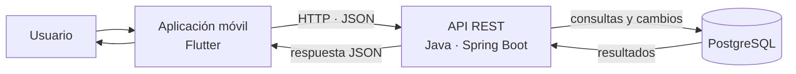

# Arquitectura

EcoRide se plantea como una solución de tres componentes: una aplicación móvil, un servidor de API y una base de datos relacional. La arquitectura es conceptual y sigue las tecnologías indicadas para el proyecto; no representa una infraestructura desplegada ni un diagrama obtenido de código fuente.

## Componentes

| Componente | Tecnología | Responsabilidad prevista |
|---|---|---|
| Aplicación móvil | Flutter | Presentar la interfaz, recoger acciones y mostrar los datos recibidos |
| Servidor | Java y Spring Boot | Exponer la API REST, validar solicitudes y aplicar reglas de negocio |
| Base de datos | PostgreSQL | Guardar usuarios, estaciones, bicicletas, reservas y trayectos |

La app móvil no debería conectarse directamente a PostgreSQL. El servidor centraliza el acceso a los datos y permite aplicar validaciones antes de aceptar cambios.

## Diagrama de componentes

## Recorrido de una petición

Al consultar las estaciones, la aplicación móvil envía una petición HTTP a la API REST. El servidor recibe la solicitud, valida sus parámetros y consulta PostgreSQL para obtener las estaciones y la disponibilidad registrada. A continuación, transforma los resultados en una respuesta JSON y la devuelve a la aplicación, que presenta la información al usuario. En una operación de escritura, como crear una reserva, el servidor también comprobaría las reglas de disponibilidad y guardaría el cambio en la base de datos antes de confirmar el resultado.

## Consideraciones de diseño

- La API es el punto de comunicación entre la aplicación y los datos.
- Las respuestas deberían comunicar errores de validación y recursos inexistentes de forma consistente.
- Las operaciones de reserva requieren controlar la concurrencia para evitar duplicidades.
- La información de disponibilidad puede cambiar con el tiempo; el servidor debería definir cómo se actualiza.
- La estimación de CO₂ debe indicar los supuestos utilizados para que su interpretación sea clara.
